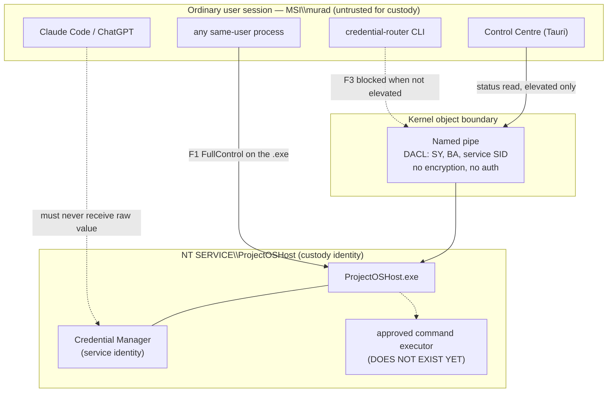
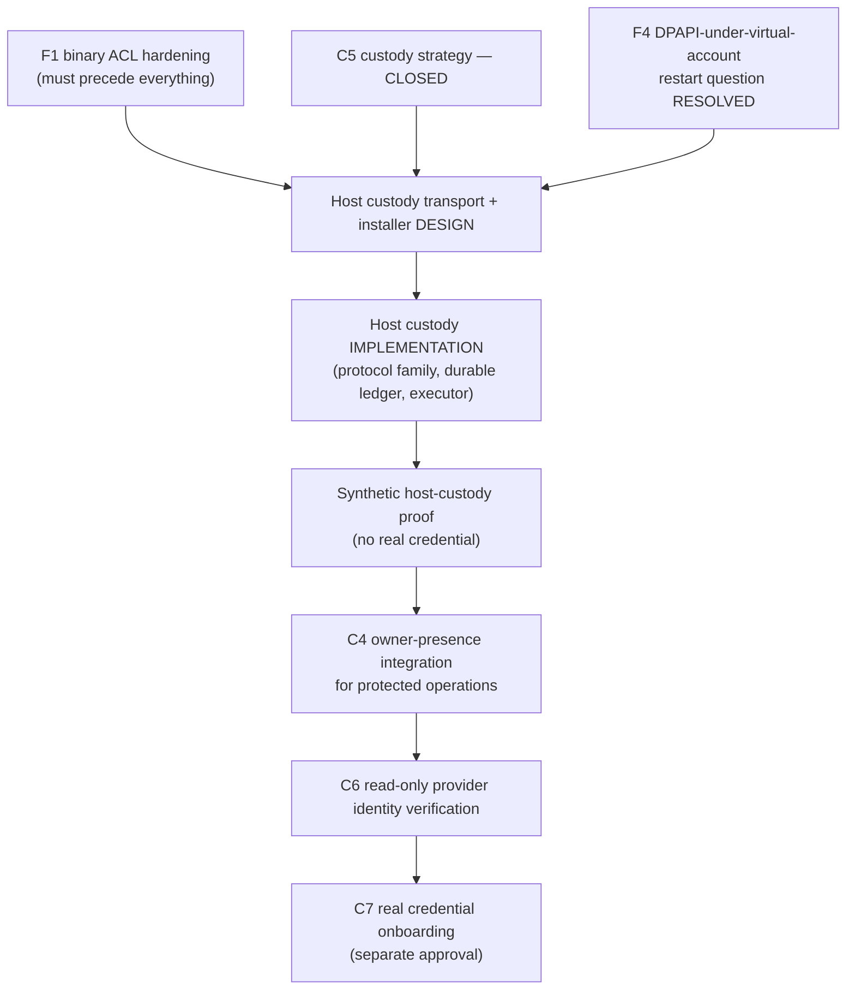

# PROJECTOS-HOST-CREDENTIAL-CUSTODY-TRANSPORT-INSTALLER-PREFLIGHT1A — AWAITING REVIEW

| | |
|---|---|
| **Project** | ProjectOS |
| **Phase** | PROJECTOS-HOST-CREDENTIAL-CUSTODY-TRANSPORT-INSTALLER-PREFLIGHT1A |
| **Date** | 2026-08-04 |
| **Repository** | `C:\dev\ProjectOS` |
| **Branch / HEAD** | `projectos-v3` @ `87661f4e72779caa2240cd1d0e9c846d3a908c98` |
| **Autonomy** | READ-ONLY technical preflight; records-only commit |
| **Decision requested** | **PREFLIGHT ACCEPTED — IMPLEMENTATION GATE REQUIRED** |

No host, IPC or installer code was written. No service was installed, started, stopped or configured. No ProgramData, ACL or registry was mutated. No credential was created, read or migrated. No provider was contacted. No `.projectops` was installed.

---

## 1. Executive summary

C5 makes `NT SERVICE\ProjectOSHost` the mandatory custody target. This preflight establishes what stands between that decision and a technically reachable implementation.

**The recommended architecture is MODEL C — host-executed operation.** The host retains the credential and runs one approved command; only an exit code and redacted output cross the boundary. This is not a novel design: the credential router's **L4 operation gate already implements exactly this shape in Node**, and the work is to move it behind the service boundary rather than to invent it.

**Five findings must be resolved before any real credential goes under host custody.** The first is live on this machine today and is the most serious:

| # | Finding | Severity |
|---|---|---|
| **F1** | `ProjectOSHost.exe` grants `MSI\murad` **FullControl**; the user can replace the binary the custody identity executes | **CRITICAL** |
| **F2** | The IPC channel has **no confidentiality and no authentication**; its "nonce" is a public compile-time constant | **CRITICAL** |
| **F3** | The pipe DACL **excludes the interactive user by design**, so no non-elevated user→host channel exists at all | **HIGH** |
| **F4** | Whether DPAPI data under a virtual service account survives restart is **NOT FOUND in source** — unresolved in either direction | **HIGH** |
| **F5** | The single-use effect-grant ledger is **in-memory**; replay protection dies at every restart | **HIGH** |

None of these makes the C5 target architecture wrong. All are fixable, and the work is enumerated in §16.

---

## 2. Source review and classification

### 2.1 Classification of material statements

| Statement | Class |
|---|---|
| HEAD `87661f4`, three branch identities as expected | SOURCE-BACKED FACT |
| Service installed, `NT SERVICE\ProjectOSHost`, SID type UNRESTRICTED, DEMAND_START, Stopped | SOURCE-BACKED FACT (live read-only query, §7) |
| `C:\ProgramData\ProjectOS` DACL is hardened and non-inherited | SOURCE-BACKED FACT (live read-only `Get-Acl`) |
| `ProjectOSHost.exe` carries `MSI\murad` FullControl, owner `MSI\murad`, no deny ACEs | SOURCE-BACKED FACT (live read-only `Get-Acl`) |
| A non-elevated user process can exercise that ACE | **INFERENCE** (high confidence; not tested, because testing means writing) |
| Protocol cannot represent a credential (V3/V4 validator pins) | SOURCE-BACKED FACT |
| Handshake nonce = repetition of a public `pub const` | SOURCE-BACKED FACT |
| Zero crypto references in the IPC crate | SOURCE-BACKED FACT |
| Pipe DACL = `SY`, `BA`, service SID only; `CurrentInteractiveUser` refused | SOURCE-BACKED FACT |
| `VerifiedApproval` has 13 public fields and no sealed constructor | SOURCE-BACKED FACT |
| `ConfirmedHandshakeEvidence::confirmed()` is public and ungated | SOURCE-BACKED FACT |
| Effect-grant ledger is `RefCell<HashMap>` / `HashSet`, "fixture-durable only" | SOURCE-BACKED FACT (source comment) |
| DPAPI survival under a virtual service account across restart | **UNSUPPORTED / NOT FOUND** |
| Recommendation of Model C | **INFERENCE** from the above |
| C5 custody target | OWNER / GATEKEEPER DECISION |

### 2.2 Survey artefact

**SURVEY ARTEFACT NOT FOUND.**

`knowledge/reports/` contains no route-survey report; the only textual match for "survey" is prose inside the credential-router report. The survey is referenced solely in the commit message of `c213078`, and it concerned the installed-host **status** response, not credentials. No remembered survey conclusion is reproduced as fact anywhere in this report.

### 2.3 A caution about reading authority state

`InstallationEffectAuthority` is sealed to a single `NotAuthorised` variant and can never report otherwise. It would be easy — and wrong — to conclude that therefore nothing can install. **The live installer does not consult it.** `install_once` gates instead on a transcribed owner phrase, and it has already run on this machine. Any future reasoning of the form "the authority type says NotAuthorised, so no effect is possible" is unsound.

Related: **`install_once` has no committed call site.** The installation that produced the running service was driven by an invocation that is not in the repository, so it cannot currently be reproduced or audited from source alone.

---

## 3. Current host capability inventory

### 3.1 Proven live on this machine

Read-only queries performed for this preflight:

```
Name=ProjectOSHost  Status=Stopped  StartType=Manual
BINARY_PATH_NAME   : C:\Program Files\ProjectOS\host\ProjectOSHost.exe
SERVICE_START_NAME : NT SERVICE\ProjectOSHost
SERVICE_SID_TYPE   : UNRESTRICTED
DEPENDENCIES       : (none)          LOAD_ORDER_GROUP : (none)
```

Per the crosswalk §8b (verified live 2026-08-01) and corroborated here: service creation, virtual-account binding, UNRESTRICTED SID configuration with authoritative re-read, live service-SID resolution, the strict ACL applied and re-read, the identity record written and verified, and start/stop/restart. The Control Centre reads real status over the named pipe.

`C:\ProgramData\ProjectOS` — **correctly hardened**: owner `NT SERVICE\ProjectOSHost`; non-inherited; SYSTEM, Administrators and the service each FullControl; **no `BUILTIN\Users` ACE**. This is the custody-grade state and it already exists.

### 3.2 Designed only, never executed

Service failure/recovery actions (no `SERVICE_CONFIG_FAILURE_ACTIONS` call exists anywhere); `AutomaticDelayedStart` (contradicted by `DemandStartOnly` and by the live `SERVICE_DEMAND_START`); the 22 pre-effect checks and 13 post-effect verifications (enum lists with no evaluator); display name as an owner decision; upgrade; uninstall; Authenticode on the service binary.

### 3.3 Cryptographic and storage primitives

DPAPI **machine scope** is real and working: `PROTECT_FLAGS = CRYPTPROTECT_LOCAL_MACHINE | CRYPTPROTECT_UI_FORBIDDEN`. A durable protected store with journalling, SHA-256 framing and `MoveFileExW(REPLACE_EXISTING|WRITE_THROUGH)` exists. Every one of these crates disclaims credential custody in its own header, and none has ever held a real secret.

`projectos-host-crypto` is contracts only — no key generation, no OS RNG, no real encryption. The synthetic adapter is `#[cfg(test)]`.

### 3.4 The authority model — real shape, unreachable today

The authority primitives are well built: sealed constructors, move-only consumption, redacted `Debug`, epoch-bound freshness. But **in a default (production) cargo build the chain is severed in four independent places** — there is no way to obtain a trusted clock, a confirmed machine authority, a verified elevation, or owner evidence. Every mint is behind a non-default feature.

And the shipping `ProjectOSHost.exe` **imports no authority primitive at all**. It links `projectos-host-core` transitively and calls none of it.

Two types are unsealed and fully reachable in production, which matters for any design that trusts them:

- **`VerifiedApproval`** — 13 public fields, no constructor, no gate. Its *shape* is right (it binds phase, project, environment, provider, operation, fingerprint, expiry, replay identity), but nothing stops in-process code from authoring one.
- **`ConfirmedHandshakeEvidence::confirmed(u64)`** — public, ungated, `confirmed: true` hardcoded.

This is tolerable only if the service process is itself the trust boundary. It means **no defence-in-depth exists inside the service**, which is a design constraint the custody implementation must respect rather than a defect to fix in passing.

---

## 4. Current IPC contract

| Property | Value |
|---|---|
| Transport | Windows named pipe, duplex, overlapped, message mode, `PIPE_REJECT_REMOTE_CLIENTS` |
| Name | `\\.\pipe\ProjectOS.Test.ServiceIdentityProof.504f534853544154` |
| Instances | 1, with `FILE_FLAG_FIRST_PIPE_INSTANCE` |
| Frame | magic `POS1` + version(2) + kind(1) + nonce(32) + len(2) = 41-byte header |
| Max frame / payload | 512 / 471 bytes; buffers 512 in and out |
| Kinds | 8, discriminants 1–8, each with one fixed payload length |
| Largest frame in existence | 62 bytes (`InstalledHostStatus`, 21-byte payload) |
| Sequence | `ControllerHello` → `ServiceReady` → `InstalledHostStatus`; single-shot, terminal |
| Correlation | **none** — no request id, no sequence number, no multiplexing |
| Timeouts | 2000 ms per step; 500 ms cancel grace; no `INFINITE` anywhere |
| DACL | `D:P` — `SY`, `BA`, service SID; rights `0x0012_019F` (no `WRITE_DAC`/`WRITE_OWNER`/`DELETE`) |
| Confidentiality | **none beyond the DACL** |
| Authentication | **none cryptographic** |
| Generic payload accessor | **NOT FOUND** — refused by validator V4 |

**The protocol cannot represent a credential, and that is enforced.** `val-cd-b4-installed-host-status-contract1a` V3 refuses `String,`, `Vec<u8>`, `HashMap`, `serde_json` and `installation_id` in the protocol; V4 refuses `payload`, `payload_bytes`, `body`, `as_bytes` and any `-> &[u8]`.

**F2 — the nonce is not a secret and provides no authentication.** It is a deterministic expansion of the public constant `INSTALLED_HOST_STATUS_RUN_ID` (`POSHSTAT`), yielding the literal 32 bytes `POSHSTATPOSHSTATPOSHSTATPOSHSTAT`. The source says so plainly and accurately: *"It is not a secret and carries no authority."* There is no challenge–response anywhere — neither side ever generates a value the other must echo. A captured `ControllerHello` is byte-identical to a fresh one and replays against any newly started server. The in-memory replay flag is per-backend-instance and, because the server object is per-invocation, effectively never fires.

The client also never verifies the server. `CreateFileW` is called with no `SECURITY_SQOS_PRESENT`, no impersonation-level control and no `GetNamedPipeServerProcessId`. Whoever wins the race to create that pipe name **is** the server, from the client's perspective.

**F3 — there is no non-elevated user→host channel.** The DACL grants only `SY`, `BA` and the service SID, and the policy explicitly enumerates `CurrentInteractiveUser` among the *broad principals it refuses*. A non-elevated process has Administrators deny-only in its filtered token, so it cannot use the `BA` ACE. The Control Centre reads status through this pipe, which means status reads succeed only when it runs elevated. Any custody design initiated from an ordinary developer session collides with this directly, and it is a deliberate policy choice rather than an oversight — so changing it is an owner decision, not a refactor.

**Adding a message family** touches ~20 coordinated sites plus two validator rebaselines: the kind enum and both discriminant functions, the single `required_payload_len` table, a new encoder and strict decoder, `FrameParseError`, the `IpcBackend` trait method pair (every implementor), a new receipt enum, a new `CapabilityScope` variant with its own owner-approval phrase, the Windows backend, both façades, `lib.rs` re-exports, and the two validators that regex-pin every existing discriminant and payload length. That expense is the design intent.

Three constraints dominate and are not negotiable at the protocol layer: the **471-byte payload ceiling**, the **absence of any request/response correlation**, and the **absence of authentication and confidentiality**.

---

## 5. Trust-boundary and threat model



| Boundary | Trust assumption | Identity evidence | Authority evidence | Exposure risk | Refusal requirement | Audit |
|---|---|---|---|---|---|---|
| Same-user process → service binary | **VIOLATED (F1)** | none | none | total — arbitrary code as the custody identity | binary must not be user-writable | file ACL |
| User process → pipe | DACL is the only gate | none beyond ACL | none | plaintext to any allowed principal | non-allowlisted principal refused by DACL | none today |
| Pipe → service | peer role is a self-assertion | **none in the shipped flow** — `contribute_ipc_peer` is never called | none | replay, impersonation | peer PID/token must be bound | none today |
| Service → Credential Manager | service identity | service SID | — | value in service memory only | never return the value | operation log |
| Service → child process | executor does not exist | — | — | value in child env | argument hygiene, minimal env | exit code + redacted output |
| Service restart | epoch changes | new generation | — | **ledger lost (F5)** | durable ledger required | journal |
| Report / log surface | redaction | — | — | secret in a report | withhold output by default | — |

**Threats and dispositions**

- **Malicious same-user process** — today, wins outright via F1. The custody boundary is only as strong as the write ACL on the binary.
- **Wrong-project / wrong-provider** — the credential router binds project, environment, provider and credential in the reference; note the **permit context digest does not fold `ProviderId`** (it folds project and environment; provider is caught only by a separate field comparison). Any host-side permit must fold provider explicitly.
- **Replayed session** — no wire-level replay protection (F2); no durable ledger (F5).
- **Poisoned PATH / cwd** — already addressed in L4 by resolving the executable against the child's actual working directory before the grant is spent. Port this behaviour; do not re-derive it.
- **Compromised child executable** — unaddressed; needs allowlisting plus binary identity.
- **Forged project root** — addressed by the out-of-checkout owner registry; a host-side design must keep that anchor outside the checkout.
- **Service crash** — no failure actions are configured, so a credential-holding service stays stopped after a crash.
- **Installer rollback** — removes only what it created; reports `Incomplete` rather than hiding failure. Adequate.
- **Offline disk access / local administrator** — explicitly out of scope in source: *"No service identity resists an administrator; ACLs raise the cost and make tampering evident, they do not prevent it."* This is the correct and honest framing and should not be overstated in future records.

---

## 6. Architecture options

### Model A — raw secret return

Host reads the credential and returns the raw value over IPC.

**REJECT.** Fails A2 and A3 outright. The wire has no confidentiality (§4), so the value is plaintext to every allowed principal; and delivering it to a user process reconstitutes exactly the Windows-user boundary C5 rejected. It would also require the protocol to represent a variable-length secret, which the validator-pinned contract forbids. No source-backed exceptional reason was found.

### Model B — opaque single-use capability

Host returns a short-lived opaque handle bound to project, provider, environment, operation, permit, session, expiry, one-time use.

**REJECT as the production design, on a specific ground.** The handle itself is defensible, and the existing `BoundedEffectGrant` already binds operation, family, target, argument, rollback, clock provider, epoch, generation, expiry and optional runtime/IPC digests. But a handle is not the objective — *using the credential* is. Model B terminates with the user process still needing the secret to make the provider call, so the raw value crosses the boundary anyway. If instead the handle is redeemed **by the host**, that is Model C.

Two further blockers: the grant ledger is in-memory (F5), so one-time-use does not survive restart; and `BoundedEffectGrant` is `!Send + !Sync` and thread-bound, so it cannot cross a process boundary as-is.

### Model C — host-executed operation ✅ **RECOMMENDED**

Host retains the credential and executes one approved command, returning only an exit code and redacted output.

**ACCEPT.** It is the only model where the raw value never leaves the custody identity, and it is the **smallest model consistent with the current architecture** because the logic already exists and is proven — the L4 operation gate implements this chain today:

1. provider intent classified by the existing guards; prohibited actions never reach a credential;
2. owner permit bound to project + environment + reference + action, with TTL, mintable only with the owner-confirmation capability;
3. argument hygiene — token-shaped arguments refused so the secret cannot reach a process listing;
4. executable resolved **before** the single-use grant is spent;
5. exactly one command, value materialised only inside `vault.useValue`;
6. **output withheld by default**, redacted when opted into, with coarse size buckets so withheld output cannot leak length.

The work is to move this behind the service boundary, not to design it.

### Model D — hybrid

Host retains the credential and issues an opaque capability consumed by a tightly controlled executor.

**REJECT for now, revisit only on evidence.** The "tightly controlled executor" runs somewhere. If it runs as the user, D reintroduces the boundary C5 rejected and inherits F1. If it runs as the service, D *is* C with extra parts. D becomes justified only if a required provider operation cannot be executed from a service context — which no source examined here demonstrates.

---

## 7. Recommended architecture

**Model C, implemented as a new IPC message family, with the L4 operation gate as the reference design.**

Shape:

- A **new message family** — never an overload of `InstalledHostStatus`, whose contract is fixed and validator-pinned. It needs its own `CapabilityScope` variant and its own owner-approval phrase, because it is not a read-only status read.
- **The 471-byte ceiling is a design input, not an obstacle.** Send *digests and bounded ids*, not free-form request bodies. The existing status record — 21 bytes of closed enums plus two hex prefixes — is the model to follow. An operation request can be expressed as a fixed record of bounded ids plus an operation fingerprint digest, with the full operation definition resolved from state on both sides.
- **Correlation must be added**, since the current protocol has none and a request/response family cannot work without it.
- **Authentication must be added before any secret-adjacent data crosses.** The current mechanism provides neither authenticity nor confidentiality, and the code says so.
- **Peer binding must be enforced**: `contribute_ipc_peer` exists but the shipped flow never calls it. The custody family must bind peer PID and creation tick, and fold `ProviderId` into the context digest, which the current permit digest does not.
- **A durable single-use ledger** replaces the in-memory one, so one-time-use survives restart.
- The service returns **exit code plus redacted-or-withheld output**. Never the value. Never a generic payload accessor.

Acceptance-criteria mapping:

| | Satisfied by |
|---|---|
| A1 custody retained | credential never leaves the service |
| A2 no raw credential in prompts/reports/logs | output withheld by default; redaction on release; size buckets |
| A3 not returned to user process | Model C by construction |
| A4 project/provider/environment specific | reference binding + provider folded into the digest (**new**) |
| A5 C4 owner presence for high-risk | owner-presence chain, once reachable (§8) |
| A6 expiry and one-use | permit TTL + durable ledger (**new**) |
| A7 replay fails closed | wire authentication (**new**) + durable ledger (**new**) + epoch |
| A8 wrong project/provider fails closed | reducer credential-scope enforcement, already fail-closed |
| A9 restart neither expands nor loses authority | new epoch + durable ledger + failure actions (**new**) |
| A10 output redacted | existing redactor, ported |
| A11 installer/ACL need future authority | separate gate, unchanged |
| A12 synthetic proof without production credentials | synthetic namespace proof already demonstrated |
| A13 C7 machine-blocked | C-gate validator (§9) |
| A14 rollback and revocation defined | §19 |
| A15 understandable without training | one command, one refusal string, no new concepts for the operator |

---

## 8. C4–C7 dependency model



**Does C4 have to come before any host operation can be tested? No — and deliberately so.** Synthetic, non-protected testing can and should precede C4, because the existing model already distinguishes fixture evidence from production evidence and *refuses* fixture evidence in the production path. That distinction is what makes early synthetic proof safe. C4 must be in force before any **high-risk or production** operation, which is the boundary the L4 gate already draws.

Two ordering corrections against the gate's suggested sequence, both source-driven:

- **F1 precedes everything.** Hardening the binary ACL is not part of custody implementation; it is a precondition for custody meaning anything. Today the user can replace the executable that would hold the credentials.
- **F4 precedes design commitment, not just implementation.** If DPAPI data under a virtual service account does not survive restart in the expected way, the storage design changes, and it is cheaper to learn that before the protocol family is built.

**C7 remains fail-closed** throughout: no dependency of C7 is satisfied by this preflight, and the machine-enforcement design in §9 exists specifically so C7 cannot open by narrative drift.

---

## 9. C-gate machine-enforcement design (design only — not implemented)

The C-gates live today only in prose. Nothing mechanically prevents C7 from being described as open.

**Proposed states** — a gate needs more than open/closed:

`decision_approved` · `implementation_complete` · `proof_accepted` · `activation_authorised` · `expired_or_revoked` · `blocked` · `not_applicable`

C5 today is exactly `decision_approved` with `implementation_complete = false` — which is precisely the distinction the current records had to state in prose.

| Item | Proposal |
|---|---|
| Schema location | `projectos/schemas/c-gate-state.schema.json` |
| Authoritative record | `projectos/state/projectos-credential-gates.json` — a **new file**, so `current-state` gains no keys |
| Validator | `val-projectos-credential-gates1a.cjs`, registered in `validate-all` |
| Dependency assertions | C7 `activation_authorised` requires C4, C5, C6 all `proof_accepted`; C5 `implementation_complete` requires the transport phase closed |
| C7 fail-closed | absent file, unparseable file, unknown state, or unmet dependency ⇒ C7 treated as **blocked**; only an explicit satisfied dependency set permits any other reading |
| Mutation tests | flip C7 to `activation_authorised` with C4 open → must fail; delete the file → must fail closed; add an unknown state → must fail; satisfy dependencies → must pass |
| Report/index integration | validator asserts each gate's state appears in the credential-router report and its index row |
| current-state compatibility | **no new keys**; the gate file is referenced, never inlined |

Proposed follow-up phase: **`PROJECTOS-CREDENTIAL-GATE-STATE-VALIDATOR1A`** — bounded to the schema, the state file, one validator, its registration, and the report/index rows.

---

## 10. Implementation work breakdown

| # | Work item | Depends on | Notes |
|---|---|---|---|
| W1 | Harden the installed binary directory and executable ACL | — | **F1. Do this first.** Remove user FullControl; owner to TrustedInstaller or SYSTEM |
| W2 | Resolve the DPAPI-under-virtual-account restart question | — | **F4.** External to this repository; document the finding either way |
| W3 | Owner decision on the user→host channel | — | **F3.** Elevate the client, add a distinct custody pipe with its own DACL, or another mechanism |
| W4 | Design wire authentication and confidentiality | W3 | **F2.** Real challenge–response; no public-constant nonce |
| W5 | Durable single-use grant ledger | W2 | **F5.** Survives restart; replaces the in-memory ledger |
| W6 | New protocol message family + correlation | W4 | Fixed-length records of bounded ids and digests; new `CapabilityScope`; new approval phrase |
| W7 | Bind peer identity and fold `ProviderId` into the context digest | W6 | `contribute_ipc_peer` exists and is never called |
| W8 | Port the L4 operation gate behind the service boundary | W5, W6 | Reference design; preserve resolve-before-spend and withhold-by-default |
| W9 | Configure service failure actions | — | The recovery plan is modelled but never applied |
| W10 | Seal `VerifiedApproval` and `ConfirmedHandshakeEvidence` | — | Or record explicitly why in-process authorship is acceptable |
| W11 | Commit a call site for `install_once` | — | The live installation is currently unreproducible from source |
| W12 | Upgrade / uninstall / credential migration paths | W5 | Currently NOT FOUND |
| W13 | C-gate state validator | — | §9 |

---

## 11. Validator and mutation plan

| Validator | Asserts | Mutations that must kill it |
|---|---|---|
| Custody protocol contract | new family's discriminants and fixed payload lengths; no `String`/`Vec<u8>`/`HashMap`/`serde_json`; no generic payload accessor; strict decoder refuses wrong kind/length/trailing bytes | add a `Vec<u8>` field; add `fn payload()`; change a payload length; accept an unknown discriminant |
| Custody executor | value never returned; output withheld by default; executable resolved before grant spent; argument hygiene; reserved env names refused | return the value; default `includeOutput` to true; move resolution after the grant; permit `--token` |
| Peer and scope binding | peer PID + creation tick bound; `ProviderId` folded into the context digest | drop the peer check; remove provider from the digest |
| Durable ledger | issuance and consumption survive a simulated restart | make the store in-memory; allow a second issuance for one key |
| Binary integrity | installed binary directory grants no non-admin write | re-add user FullControl |
| C-gate state | dependency graph; fail-closed on absent/unknown | open C7 with C4 open; delete the file |

Every mutation restored byte-identically and verified with `cmp`, per established practice.

---

## 12. Synthetic and live proof plan

**Synthetic — no real credential, no provider contact:**

1. store a synthetic value under the service identity;
2. issue one operation request over the new family; assert the raw value never appears on the wire, in stdout, in any log or in any report;
3. run one approved command that echoes only an exit code;
4. assert refusals: wrong project, wrong provider, wrong environment, expired permit, replayed request, unknown peer, oversized frame, wrong kind;
5. assert no lease, no grant and no child process survives any refusal;
6. restart the service; assert the consumed grant is still consumed (**this is the test F5 currently fails**);
7. assert the synthetic store returns to its initial inventory, verified with a whole-segment prefix whose count is observed to rise before it returns to zero.

**Live machine proof (separate gate, elevated, owner-present):** service installed with failure actions; ACL re-read authoritatively after application; one synthetic end-to-end operation; stop/restart correspondence; rollback exercised.

---

## 13. Recovery and rollback

| Scenario | Current | Required |
|---|---|---|
| Service crash | no failure actions; stays stopped | configure the modelled recovery plan (W9) |
| Reboot | DEMAND_START; not running | owner decision: leave manual or make delayed-auto |
| Grant issued, host crashed | `IssuanceState::Indeterminate` exists | durable ledger must persist it; indeterminate must fail closed |
| Credential revoked at provider | not modelled end to end | revocation revision exists in `CredentialScope`; wire it |
| Bad install | rollback removes only what it created; reports `Incomplete` honestly | adequate; keep |
| Identity conflict | writer refuses intact, no overwrite | adequate; keep |
| ACL drift | `apply_and_verify` re-reads; `ReconciliationRequired` never retried silently | adequate; keep |

---

## 14. Owner decisions required

1. **F1 remediation** — harden the binary ACL. Recommend proceeding; custody is meaningless without it.
2. **F3 channel decision** — elevate the client, add a separate custody pipe with a deliberately different DACL, or another mechanism. This reverses a stated policy (`CurrentInteractiveUser` is currently refused by design), so it is yours, not mine.
3. **F4** — accept that the DPAPI restart question must be answered outside this repository before the storage design is fixed.
4. **Start type** — leave DEMAND_START or move to delayed-auto for a credential-holding service.
5. **W10** — seal the two unsealed authority types, or accept in-process authorship and record why.
6. **W11** — authorise committing an `install_once` call site so the installation is reproducible.
7. Whether **`PROJECTOS-CREDENTIAL-GATE-STATE-VALIDATOR1A`** proceeds independently of the transport work.

---

## 15. Proposed next bounded phases

| Phase id | Scope |
|---|---|
| `PROJECTOS-HOST-BINARY-CUSTODY-ACL-HARDENING1A` | F1 only; elevated; live ACL correction and re-read |
| `PROJECTOS-HOST-CUSTODY-STORAGE-PREFLIGHT1A` | F4; read-only; settle DPAPI restart behaviour |
| `PROJECTOS-HOST-CUSTODY-CHANNEL-DECISION1A` | F3/F2; design-only; channel and authentication design |
| `PROJECTOS-HOST-CUSTODY-PROTOCOL-FAMILY1A` | W6/W7; new message family plus validators |
| `PROJECTOS-HOST-DURABLE-GRANT-LEDGER1A` | W5 |
| `PROJECTOS-HOST-CUSTODY-EXECUTOR1A` | W8; port the L4 gate behind the service boundary |
| `PROJECTOS-CREDENTIAL-GATE-STATE-VALIDATOR1A` | §9 |

---

## 16. Prohibited-action confirmation

No host, IPC or installer implementation. No service install, start, stop, restart or configuration. No ProgramData, ACL or registry mutation. No key provisioning. No credential input, read or migration. No provider MCP or provider call. No `.projectops` installation. No production activity, database mutation, deployment, real send or payment. No `current-state` or crosswalk change. No validator or schema implementation. No C4/C6/C7 closure. No credential-router closure. No branch deletion, rebase, amend, force push or tag. No other repository accessed. `gh auth switch` never run.

Machine inspection was read-only throughout: `Get-Service`, `sc.exe qc`, `sc.exe qsidtype`, `Get-Acl`, and a token-elevation query. Nothing was written.

---

## 17. Decision requested

**PREFLIGHT ACCEPTED — IMPLEMENTATION GATE REQUIRED**

The C5 target is technically reachable and the recommended model is the smallest one consistent with what already exists. Five findings must be resolved first, and **F1 is live on this machine now**: the account that runs Claude Code holds `FullControl` over the executable the custody identity runs. Until that is fixed, moving credentials behind the service would move them behind a door whose hinges the untrusted side controls.

This phase remains **AWAITING REVIEW**. `acceptedPhaseCount` unchanged at 4 / 19, `EXECUTION_READY` false, `installationAuthority` NotAuthorised, C4/C6/C7 open, C7 prohibited.
